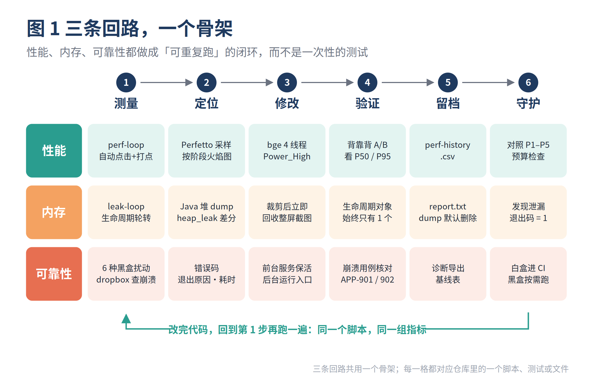
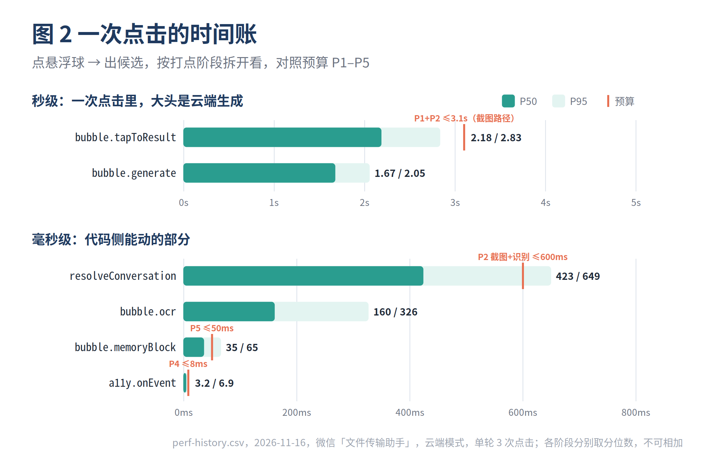
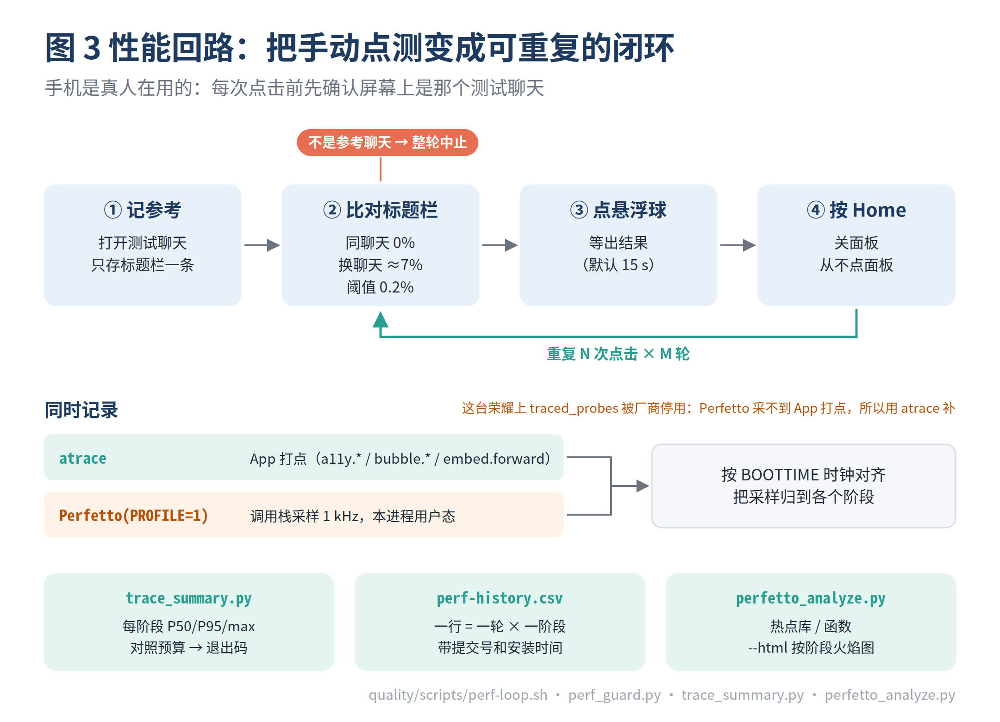
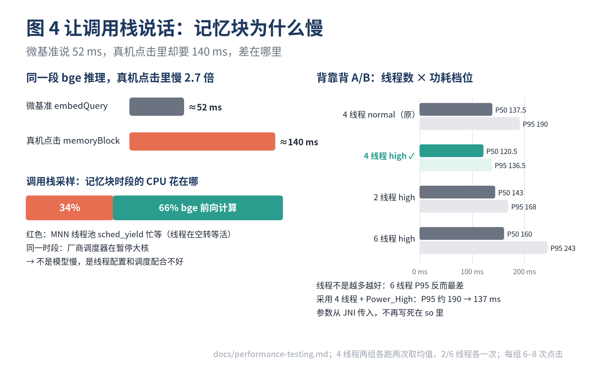
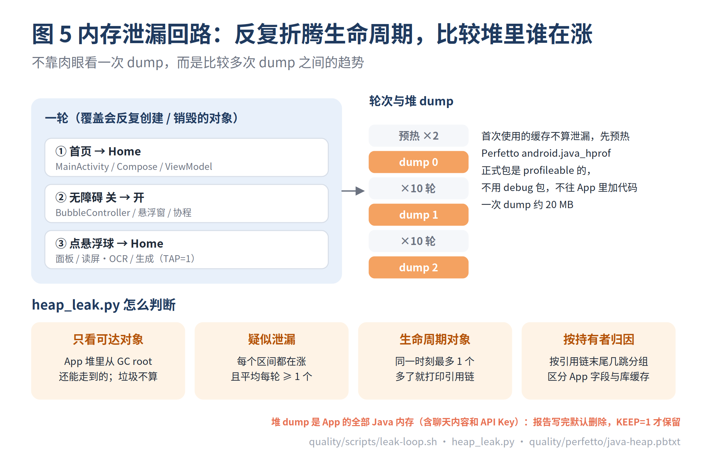
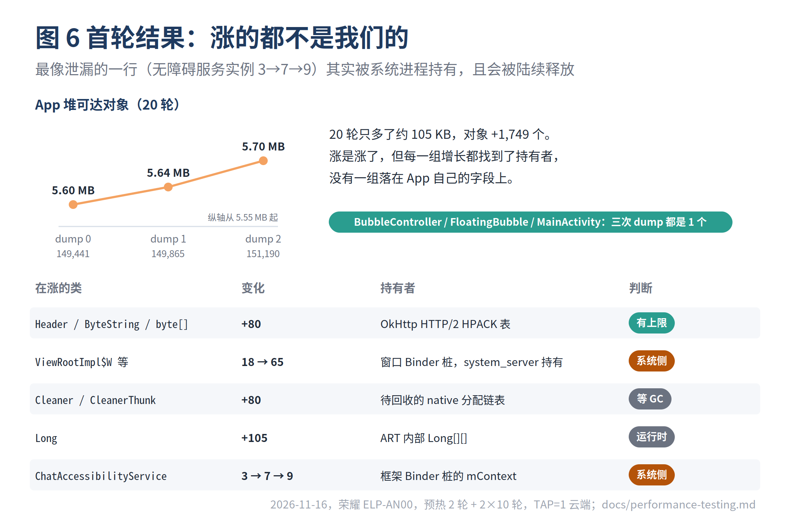
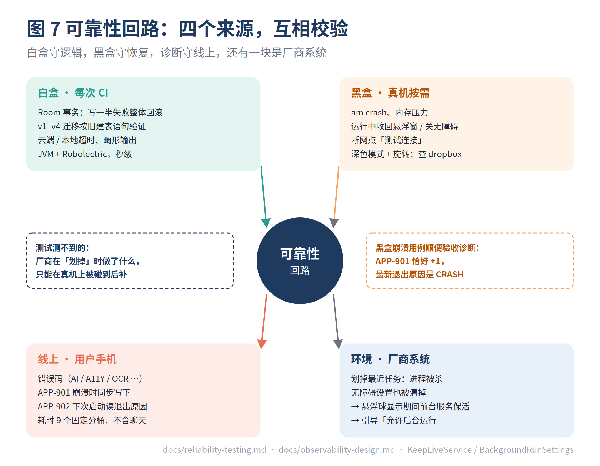
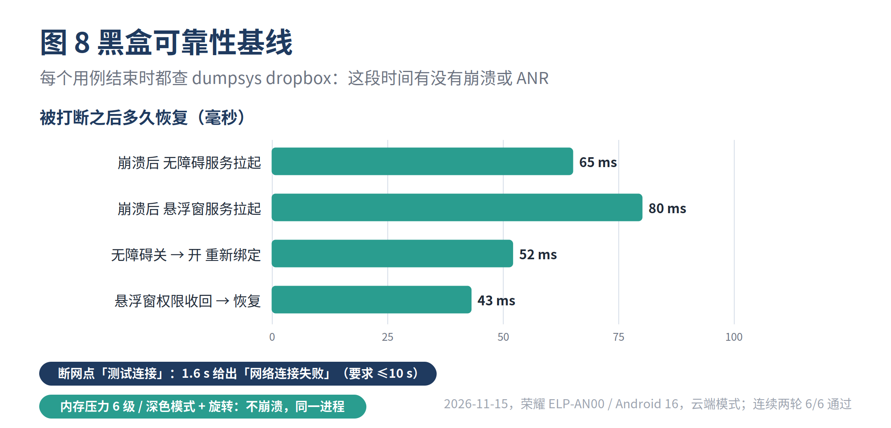
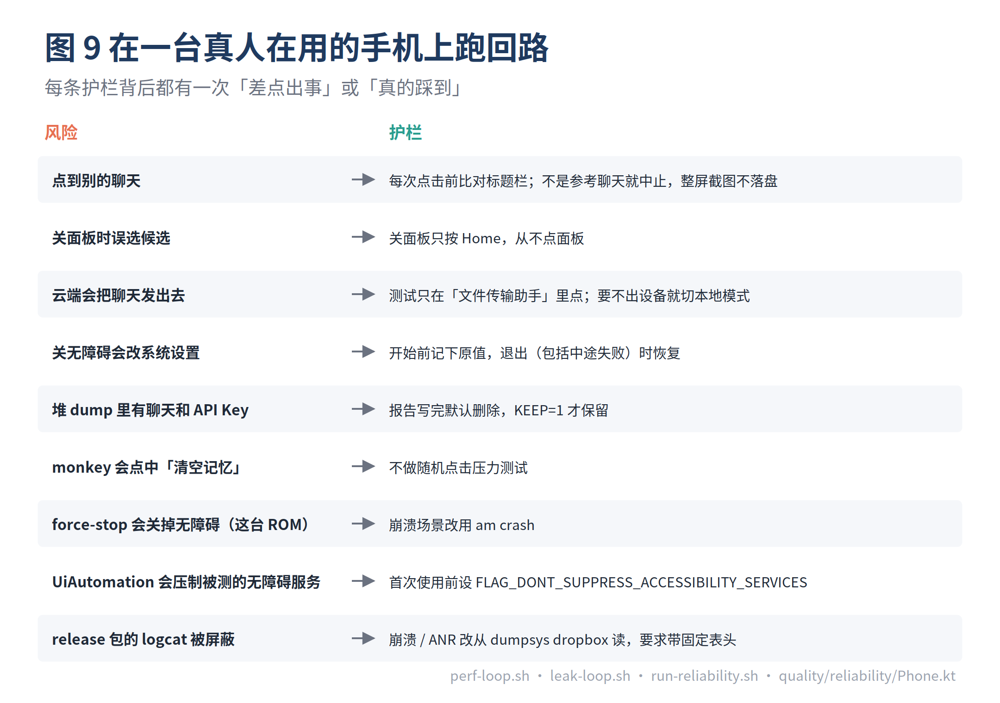

# 把性能、内存、可靠性做成回路：一个读屏 AI 助手的真机质量闭环复盘

> 上一篇我们讲了怎么从 0 个测试搭起五层安全网。安全网解决的是“有没有”，这一篇讲“能不能反复用”：性能、内存泄漏、可靠性各自做成一条**可以重复跑的真机回路**，改一行代码，就用同一个脚本、同一组指标再跑一遍。文章复盘三条回路是怎么搭的、用它们定位并修掉了什么、哪些优化我们决定不做，以及一个贯穿始终的约束：**测试跑在一台真人正在用的手机上**。

---

## 一、为什么是“回路”，而不是“一次测试”

这个 App 的工作方式决定了它的性能和可靠性问题几乎只在真机上出现：

- 用户在微信、QQ、Soul 里聊天时，屏幕边上有一个**悬浮球**；
- 点一下，App 通过**无障碍服务**读当前聊天（读不到文字的 App 就截屏做 OCR），交给云端或端侧模型生成几条候选；
- 它还会从用户发过的话里学习说话风格，生成时用端侧 bge 向量模型做**语义召回**。

一次点击要经过别人 App 的界面、系统的无障碍框架、截屏、OCR、一个端侧小模型、一次网络请求，任何一段在模拟器或单元测试里都看不到真实耗时。厂商系统还会在背后做各种事：调度大小核、杀后台、清设置。

所以我们没有满足于“测一次、写个结论”，而是给三类问题各搭了一条回路，它们共用一个骨架：

**测量 → 定位 → 修改 → 验证 → 留档 → 守护**，最后一步把检查固化下来，下一次改代码再回到第 1 步。图里每一格都对应仓库里的一个脚本、测试或文件，下面逐条展开。

---

## 二、性能回路

### 2.1 先算一笔账：一次点击的时间花在哪

我们在关键路径上打了 `Trace` 打点（没抓 trace 时只是一次已缓存的标签检查，零分配），把“点悬浮球 → 出候选”拆成几个阶段。下图是在微信「文件传输助手」里、云端模式下的一轮实测：

几个直接的结论：

1. **大头是云端生成**：一次点击约 2.2 s，其中 1.4–1.9 s 在等模型返回。这部分代码侧几乎做不了什么。
2. **代码能动的是毫秒级的那几段**：读聊天（截屏 + OCR 约 0.4 s）、记忆召回（bge 推理）、无障碍事件回调。
3. **每一段都有预算**，写在质量属性文档里：点击到出结果 P1、截屏识别额外开销 P2、单个无障碍事件 P4（≤ 8 ms，不能让聊天 App 掉帧）、记忆召回 P5（≤ 50 ms）。

注意图上的数字是**每个阶段各自的分位数**，不能相加；样本也只有一轮 3 次点击。单看一次不说明什么，这正是要做成回路的原因。

### 2.2 把手动点测变成可重复的闭环

最初测“点击到出结果”靠人手点、人眼看，结论是“大概两三秒”。要比较一次修改前后的差别，这远远不够。于是有了 `perf-loop.sh`：

它做四件事：

- **自动点击**：在指定聊天里反复点悬浮球，等结果，按 Home 关面板，重复 N 次 × M 轮；
- **录打点**：atrace 录下每次点击的各个阶段；
- **汇总并对照预算**：`trace_summary.py` 算出每阶段 P50 / P95 / 最大值，超预算就以非零退出码结束；
- **留档**：每一轮每个阶段追加一行到 `perf-history.csv`，带上被测包的提交号和安装时间。改代码前后各跑一轮，直接比较两行。

需要看“CPU 花在哪”时，加 `PROFILE=1`，同时用 Perfetto 以 1 kHz 采样本进程的调用栈。

这里有一个厂商带来的坑：**这台荣耀手机停用了 `traced_probes`**，Perfetto 采不到调度、CPU 频率，也采不到 App 自己的打点。只有调用栈采样（`traced_perf`）能用。我们的办法是两份数据一起录：atrace 给阶段边界，Perfetto 给调用栈，两者都用 **BOOTTIME 时钟**，`perfetto_analyze.py` 按时间把每个采样归到它所在的阶段。后来又加了 `--html`，每个阶段生成一张可点击放大的火焰图，单文件、不依赖外网。

### 2.3 让调用栈说话：记忆块为什么慢

闭环跑起来后，第一个跳出来的问题是记忆块：

微基准里，bge 给一段 12 行的查询算向量只要 **52 ms**；可真机点击里，记忆块要 **约 140 ms**，慢了 2.7 倍。同一段代码、同一个模型，差在哪？

调用栈采样给了答案：

- 记忆块的时间几乎全是 `embed.forward`，也就是 bge 推理本身；
- 其中 **34% 的采样落在 MNN 线程池的 `sched_yield` 上**，线程在空转等活；
- 同一时段，厂商调度器在**暂停大核**。

也就是说，不是模型算得慢，而是“4 个线程忙等 + 调度器不给大核”配合得很差。微基准跑在安静的手机上，碰不到这种情况。

原来的线程数和功耗档位写死在 native 库里。我们把它们改成从 JNI 传入，重编 `libembedjni.so`，然后在真机上做**背靠背 A/B**：同一台手机、同一个聊天，每组 6–8 次点击，几组配置紧挨着跑完，尽量让温度和后台状态一致。结果有两点值得记下：

- **线程不是越多越好**：6 线程的 P95 反而最差（243 ms），2 线程也比 4 线程慢；
- 最后采用 **4 线程 + `Power_High`**，P95 从约 190 ms 降到约 137 ms。

这个结论如果只看微基准，大概率会得出“加线程”的相反答案。

### 2.4 决定不做的优化，和后来又做了的

回路的另一个作用，是让“不做”也有依据。性能文档里明确记了三项暂不做的事：

- **记忆块压到 50 ms 预算**：配置已经调到头，再降只能缩短查询（现在取最近 12 行聊天）或提前计算，会影响召回效果，这是产品取舍，不是工程问题。
- **生成期间的加载动画**：云端模式下它占约一个核的 17%；本地模式下会和端侧推理抢 CPU，是否改成静态提示待定。
- **OCR 前裁剪截图**：当时估计只能少约 14% 像素、省约 50 ms，而识别坐标、按像素判断发送者的逻辑都要跟着平移，压线的消息还可能被截掉半截，收益不抵风险。

最后这一项后来又做了。读屏模块重构后，截图时已经能拿到每条消息气泡的边界，于是在 #75 里把截图裁到“键盘以上、所有气泡的并集”。这次的动机主要是**准确性**：标题栏、输入栏、气泡周围的面板在 OCR 之前就裁掉了，不会被误识别成聊天内容。当初担心的坐标平移，用 7 个单测覆盖住了。

同一件事两次结论相反，原因是前提变了：第一次没有消息边界，只能按固定比例裁，风险大；第二次有了精确边界，风险可以用测试兜住。

---

## 三、内存泄漏回路

### 3.1 思路：反复折腾生命周期，比较堆里谁在涨

这个 App 有几类会被反复创建、销毁的对象：设置页的 Activity 和 Compose 界面、悬浮球和面板的窗口、每次点击的读屏和生成流程。泄漏的典型表现是：旧实例被某个字段挂住，每来一轮就多一个。

只看一次堆 dump 很难判断“这 300 个对象多不多”。所以泄漏回路的核心是**比较趋势**：

`leak-loop.sh` 每一轮做三件事：打开首页再按 Home；关掉无障碍服务等悬浮球消失，再打开等它回来；在测试聊天里点一次悬浮球。先预热 2 轮（首次使用的缓存不算泄漏），之后每 10 轮用 Perfetto 的 `android.java_hprof` dump 一次 Java 堆。

有两点选择值得说：

- **直接在正式包上 dump**。release 包本身就是 profileable 的，不需要 debug 包，也不往 App 里加任何检测代码；Java 堆 dump 也不依赖被厂商停掉的 `traced_probes`。
- **堆 dump 就是 App 的全部 Java 内存**，里面有聊天原文和 API Key。所以报告生成后默认删除，只有显式设 `KEEP=1` 才保留。

`heap_leak.py` 的判断规则只有四条：只看从 GC root 还能走到的对象；某个类在每个区间都涨、且平均每轮至少多 1 个，才算疑似泄漏；`BubbleController`、`FloatingBubble`、`MainActivity` 这类生命周期对象同一时刻最多 1 个，多了就打印从 GC root 到它的最短引用链（字段名用 R8 mapping 还原）；最后按引用链末尾几跳分组，看增长落在谁手里。

### 3.2 首轮结果：涨的都不是我们的

预热 2 轮加 2 × 10 轮，App 堆可达对象从 149,441 涨到 151,190，约多了 105 KB。涨是涨了，但每一组都找到了持有者：

- OkHttp HTTP/2 的 **HPACK 动态表**：有上限（默认 4 KB），不是泄漏；
- 窗口的 **Binder 桩**（`ViewRootImpl$W` 等）：GC root 是 JNI 全局引用，由 system_server 持有，`ViewRootImpl` 本身始终是 2 个；
- `Cleaner`：等待回收的 native 分配；`Long`：ART 内部。

最吓人的一行是 **`ChatAccessibilityService` 实例 3 → 7 → 9**。无障碍服务是常驻服务，它要是泄漏，问题就大了。引用链显示，持有它的是框架里 `IAccessibilityServiceClientWrapper` 的 `mContext`，同样是 system_server 那边的 Binder 桩：每次重开无障碍，系统新建一个服务实例，旧实例要等系统释放 Binder 才能回收。而且增长不是每轮一个，说明旧实例在被陆续释放。App 代码里没有任何地方引用旧实例。

App 自己的生命周期对象，三次 dump 都是 1 个。**首轮结论：没有 App 侧泄漏。** 但如果没有“按持有者归因”这一步，我们很可能会去“修”一个系统行为。

### 3.3 内存峰值：不是泄漏，也值得管

泄漏之外，另一类内存问题是**峰值**。读聊天走截图路径时，一张整屏截图拷成软件位图约 13 MB。这里做过三处修改：

- 截图回调改到后台线程，这次拷贝不再占主线程；
- 用户连续点击、上一次请求被取消时，**回收已经拷出来的位图**，不再等 GC；
- 截图裁剪后**立即回收整屏位图**，识别阶段内存里少一张整屏图。

---

## 四、可靠性回路

### 4.1 四个来源，互相校验

上一篇讲过白盒测试（数据库事务、迁移、超时）和真机黑盒测试（崩溃、内存压力、收回权限、断网、旋转）。这一篇想补的是它们怎么连成回路，以及测试覆盖不到的那一块：

- **白盒**守逻辑，每次 CI 都跑，秒级；
- **黑盒**守恢复，在真机上按需跑；
- **线上诊断**守用户手机：错误码、崩溃记录、退出原因、关键操作耗时，只记录码和数字，不含聊天内容，用户主动导出才离开手机；
- **厂商系统**：测试测不到、只能在真机上被碰到的部分。

### 4.2 让测试顺便验收诊断

诊断系统的价值在于“出了问题能看到”，可它自己要是没写进去，平时完全发现不了。我们的做法是让黑盒测试**顺便验收诊断**：

- 崩溃用例用 `am crash` 让进程崩溃，前后各导出一次诊断；
- 要求 `APP-901`（崩溃时在未捕获异常处理器里**同步写下**）**恰好多 1 条**；
- 要求有新的 `APP-902`，且最新退出原因是 `CRASH`（下次启动时从系统的 `ApplicationExitInfo` 读到）。

同样，每个黑盒用例结束时都会查 `dumpsys dropbox`，看这段时间有没有崩溃或 ANR；崩溃用例要求恰好 1 次，这同时验证了“检测本身有效”。这台手机屏蔽了 release 包的 logcat，如果靠日志判断崩溃，所有用例都会“通过”。

诊断里还有一块是**耗时分布**：点击到出结果、云端 / 本地生成、截图识别、一次学习，各按 9 个固定分桶（< 250 ms … ≥ 30 s）计数，导出时报 P50 / P95。它只接在点击路径和学习上，读屏事件回调不加，不给热路径添负担。这样用户那边反馈“变慢了”，导出里就有分布可看。

### 4.3 基线

进程崩溃后，无障碍服务 65 ms、悬浮窗服务 80 ms 内被系统拉起；无障碍关掉再打开，52 ms 内重新绑定；断网时点“测试连接”，1.6 s 给出“网络连接失败”，不会一直转圈。这组数据是 11-15 测的，连续两轮 6/6 通过。之后悬浮球从 Service 改成了由 Application 管理的普通对象，下次跑黑盒时这张表会更新。

### 4.4 测试测不到的：厂商在“划掉”时做了什么

所有黑盒用例都过了，真机上还是出了一个问题：**从最近任务里划掉 App 后，荣耀的后台管理会停掉进程，并顺带清掉无障碍设置**。用户下次打开聊天，悬浮球不见了，还得去系统设置里重新打开无障碍。

这个问题测试很难覆盖：它依赖厂商策略，不同品牌、不同版本表现不一样。我们做了两件事：

- **悬浮球显示期间用前台服务保活**：`KeepLiveService` 只做一件事，挂一个常驻通知，随悬浮球启停；它不是 sticky 的，被杀后等无障碍重连、悬浮球回来时再由 Application 启动；启动失败记错误码 `BUB-501`。
- **引导用户“允许后台运行”**：各厂商的“应用启动管理”没有公开接口，只能把用户带到对应页面。首页加了一个入口，按顺序尝试荣耀、华为、小米、OPPO / 一加、vivo 的设置页，打不开就试下一个，最后兜底到应用详情页。状态读不到，所以做成按钮加说明，不显示勾选。

回路的意义在这里也成立：这次从真机上碰到的问题，修完要在诊断里留下记录（`BUB-501`），下一次再出现时能看到。

---

## 五、在一台真人在用的手机上跑回路

三条回路有一个共同的前提：**测试机是一台日常在用的手机**，上面有真实的聊天、真实的 API Key、真实的系统设置。自动化脚本出一点错，后果就是真实的。

图里每一条护栏背后都有一次“差点出事”或“真的踩到”：

- **点到别的聊天**。有一次手动点测时，输入法已经收起，按固定坐标的一次点击落进了一个真实的私聊（没有发出任何内容，按返回退出了）。之后 `perf-loop.sh` 在每次点击前都比对聊天标题栏：同一个聊天变化 0%，换一个聊天约 7%，阈值取 0.2%；不是参考聊天就整轮中止。只保留标题栏这一条截图，整屏截图从不落盘。
- **关面板时误选候选**。按坐标点面板的关闭按钮，标题变成两行时按钮会下移，结果点中了一条候选，被自动填进了聊天输入框。从此关面板只按 Home：离开聊天 App 时悬浮球隐藏、面板自动移除，不会误触。
- **改系统设置**。泄漏回路要关无障碍，脚本开始前记下原值，退出时（包括中途失败）恢复。
- **monkey 和 force-stop**。随机点击会点中“清空记忆”；而在这台 ROM 上，`force-stop` 会把 App 从已启用的无障碍服务里移除。所以不做 monkey，崩溃场景用 `am crash`。
- **测试框架自己干扰被测对象**。UiAutomator 连上 UiAutomation 后，默认会暂停设备上其他的无障碍服务，包括被测 App 的。必须在第一次使用前设置 `FLAG_DONT_SUPPRESS_ACCESSIBILITY_SERVICES`。

---

## 六、几条可以带走的经验

1. **性能问题先看真机调用栈，再动参数**。微基准 52 ms、真机 140 ms，差距来自线程忙等和厂商调度，只看微基准会得出相反的结论。
2. **A/B 要背靠背，要看 P95**。多线程在 P50 上差别不大，在 P95 上差了 100 ms。
3. **泄漏要看趋势、要归因到持有者**。单次 dump 里“多出来的对象”大多是有界缓存和系统持有的 Binder 桩；不归因，就会去修一个不存在的泄漏。
4. **让测试验收可观测性**。诊断写没写进去，平时发现不了；让崩溃用例核对错误码，才知道线上出事时真的能看到。
5. **“不做”也要写下来，连同前提**。OCR 裁剪第一次不做、第二次做了，都对，因为前提变了。把前提写进文档，下次才知道该不该重新评估。
6. **真机回路的第一需求是安全，不是覆盖率**。在真人的手机上，先保证不点错、不泄密、不改坏设置，再谈跑多少轮。

---

**附：数据与脚本**

| 内容 | 位置 |
|---|---|
| 性能回路与调用栈采样 | `quality/scripts/perf-loop.sh`、`perf_guard.py`、`trace_summary.py`、`perfetto_analyze.py`、`quality/perfetto/tap-profile.pbtxt` |
| 内存泄漏回路 | `quality/scripts/leak-loop.sh`、`heap_leak.py`、`quality/perfetto/java-heap.pbtxt` |
| 可靠性黑盒 | `quality/reliability/`、`quality/scripts/run-reliability.sh` |
| 方法与基线 | `docs/performance-testing.md`、`docs/reliability-testing.md`、`docs/observability-design.md` |
| 本文配图 | `docs/article/quality-loops/build_figures.py`（SVG 生成后用 cairosvg 渲染为 2 倍 PNG） |

测试机：荣耀 ELP-AN00（骁龙 8s Gen3 / Android 16）。文中数据测于 2026-11-14 至 11-16，图 2 来自 `perf-history.csv` 的单轮记录，图 4、图 6、图 8 来自上表文档。
