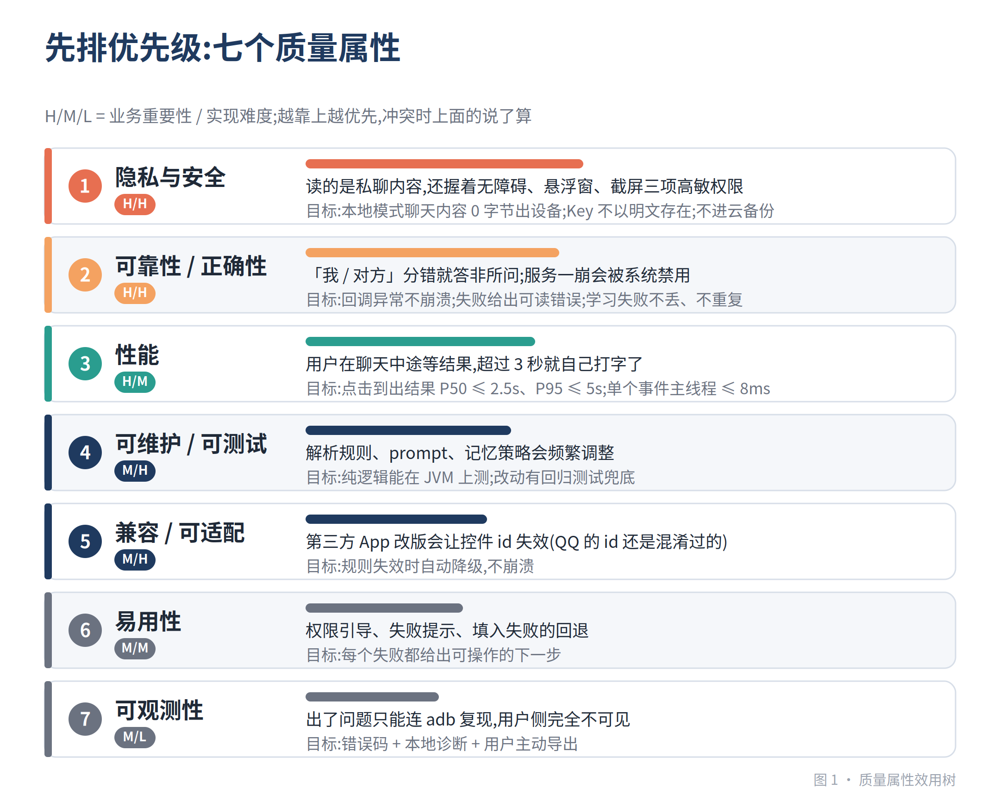
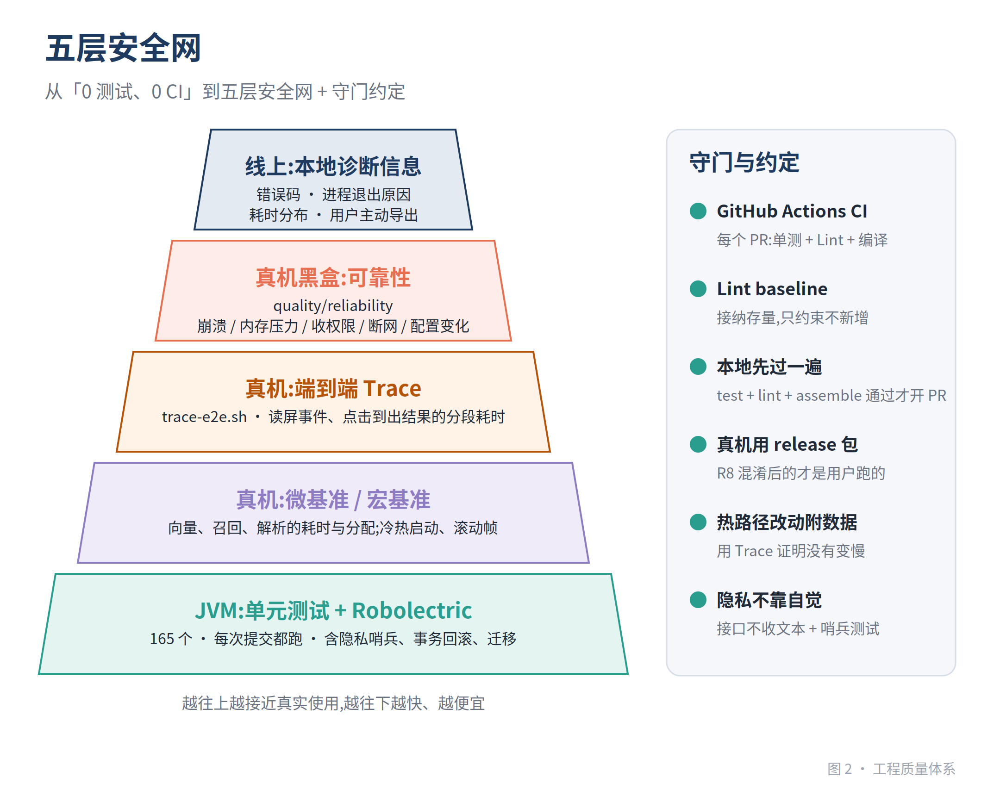
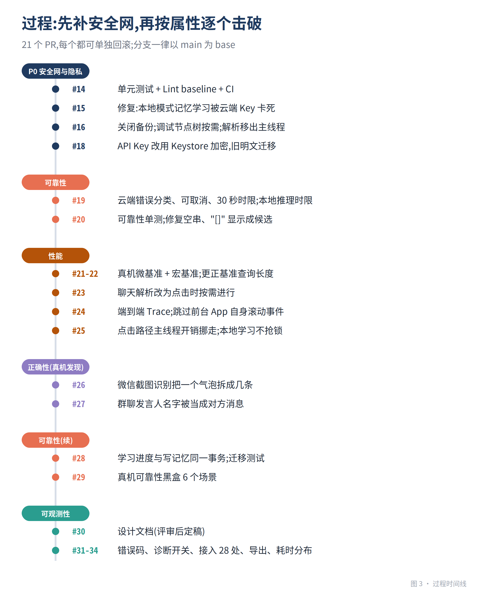
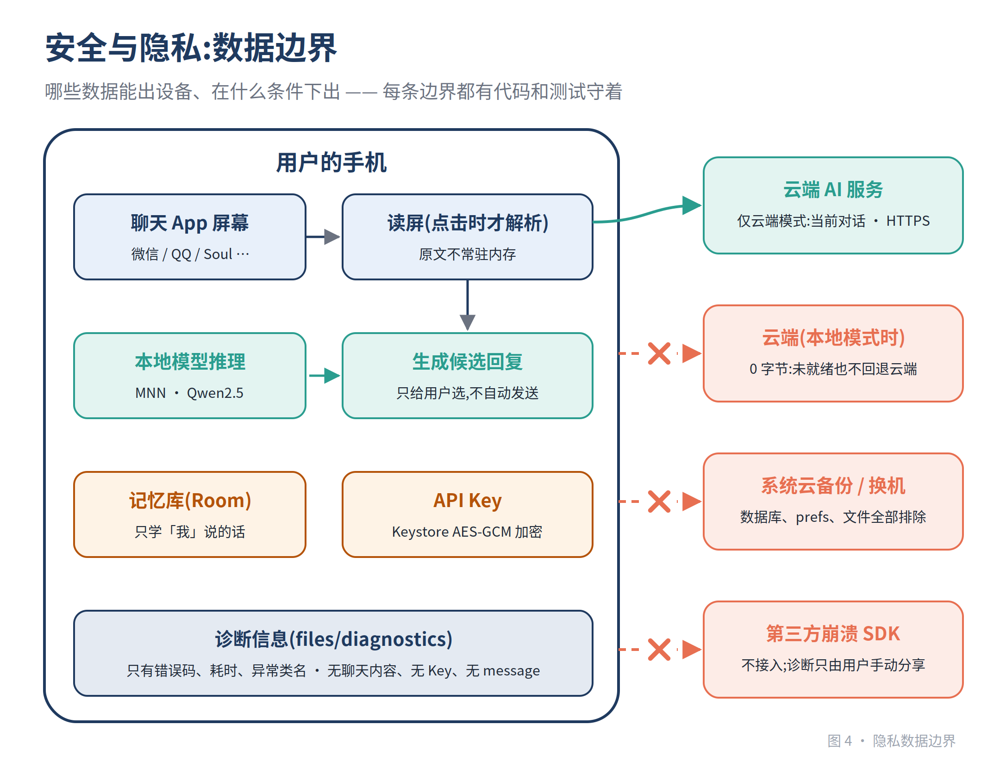
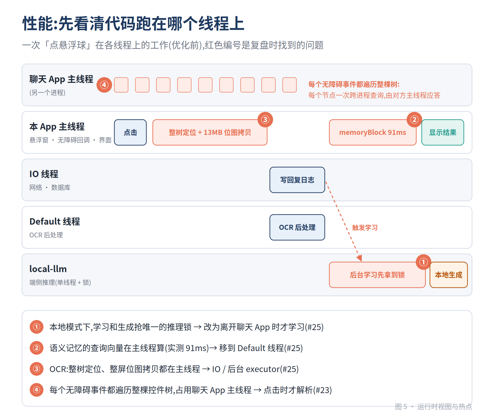
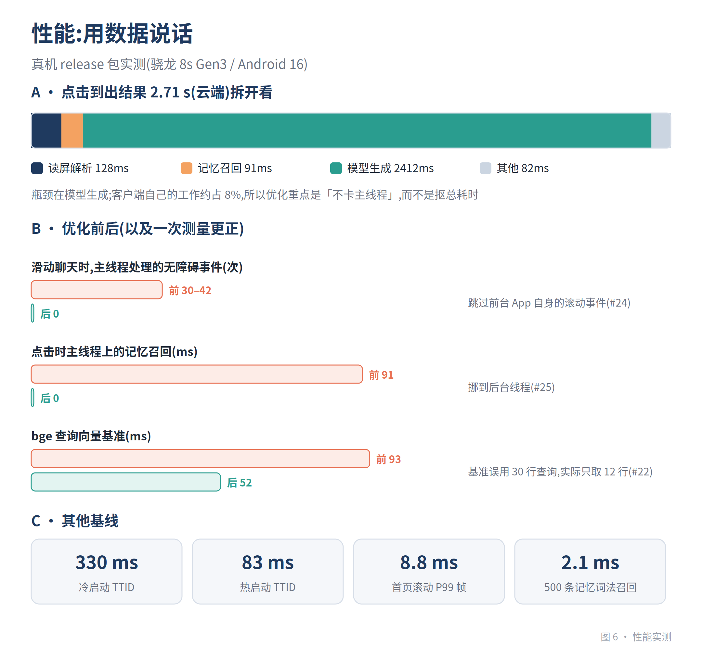
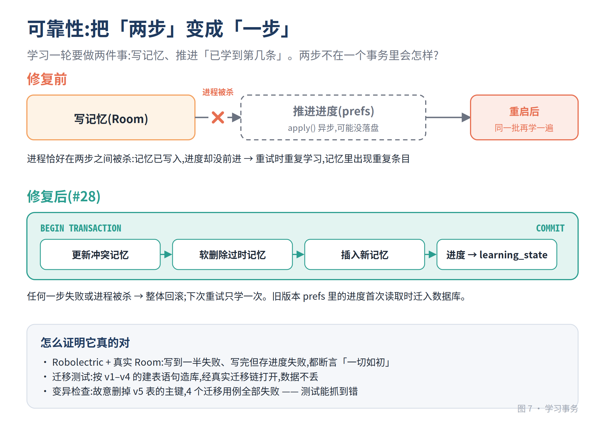
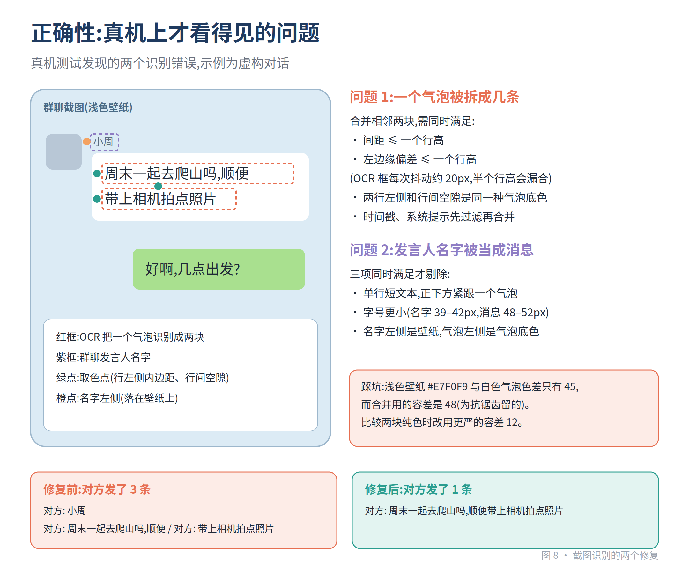
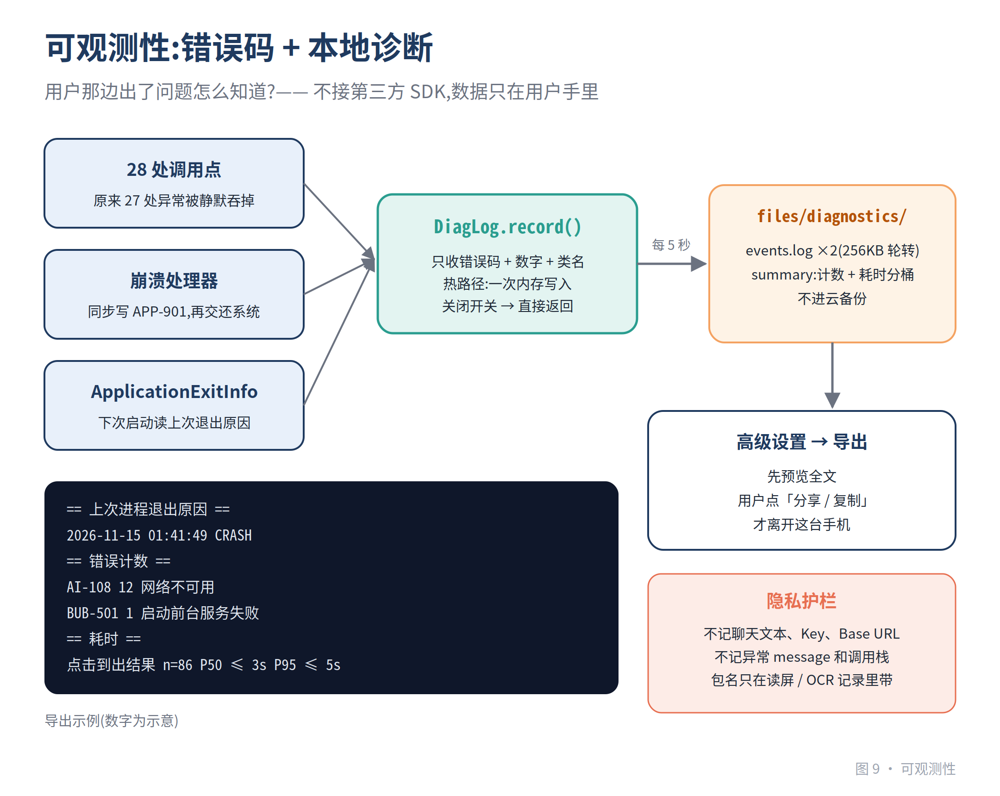

# 从 0 测试到五层安全网:一个读屏 AI 聊天助手的质量工程复盘

> 一个 Android App 功能做完了,但测试为 0、CI 为 0、出了问题只能连 adb 看。接下来一天多的时间,我们用 21 个 PR 把它的**安全、性能、可靠性**逐项补齐,中间踩了不少坑。这篇文章复盘整个过程:怎么排优先级、怎么搭安全网、每个属性做了哪些设计,以及**过程中发现了哪些问题,有些问题恰恰出在测试本身**。

---

## 一、背景:一个"敏感"的 App

这个 App 做的事情不复杂:

- 用户在微信、QQ、Soul 等聊天 App 里聊天时,屏幕边上有一个**悬浮球**;
- 点一下,App 通过**无障碍服务**读出当前屏幕上的聊天内容(读不到文字的 App 就截屏做 OCR);
- 交给大模型(**云端 API** 或**手机上的端侧模型**)生成几条候选回复,用户选一条,自动填进输入框;
- 它还会从用户自己发过的话里**学习**说话风格和个人信息,让回复越来越像本人。

功能跑通之后,我们发现它的质量问题比一般 App 更尖锐:

1. **它读的是私聊内容**,手里还握着无障碍、悬浮窗、截屏三项高敏权限;
2. **它寄生在别人的 App 上**:微信、QQ 一改版,读屏规则就可能失效;
3. **它在用户等待时工作**:用户正在聊天,等候选超过三秒,就自己打字了;
4. **它是个常驻服务**:无障碍服务一崩溃,系统会把它禁用,用户得自己去设置里重新打开。

而当时的工程状态是:**0 个测试,0 个 CI,0 条静态检查**。

---

## 二、先排优先级:七个质量属性

质量属性之间经常冲突:为了可测性做的抽象可能拖慢热路径,为了可观测性加的日志可能泄露隐私。所以第一步不是写代码,而是**把优先级写下来,冲突时按它裁决**。

几个关键的取舍:

- **隐私排第一**。哪怕牺牲一些功能和便利,聊天内容也不能意外离开手机。
- **每个属性都写成可验证的场景**:不说"要快",而说"点击到出结果 P50 ≤ 2.5s、P95 ≤ 5s";不说"要安全",而说"本地模式下,聊天内容 0 字节发往网络"。
- **可观测性排在最后,但不能是 0**。后面会看到,这一项"补课"时发现的问题一点也不少。

---

## 三、先建安全网,再动手术

没有测试就重构,等于蒙着眼睛做手术。所以第一个 PR 只做一件事:**搭起单元测试、Lint 和 CI**。

最终形成了五层:

| 层 | 在哪里跑 | 解决什么问题 |
|---|---|---|
| JVM 单元测试 + Robolectric | 每次提交,CI | 逻辑对不对;从 0 增加到 **165 个** |
| 微基准 / 宏基准 | 真机 | 某段代码有多快、分配多少内存;启动和滚动是否流畅 |
| 端到端 Trace | 真机 release 包 | 读屏事件、点击到出结果,每一段花了多久 |
| 可靠性黑盒 | 真机 release 包 | 崩溃、内存压力、权限被收回、断网、配置变化后,能不能恢复 |
| 本地诊断信息 | 用户手机 | 用户那边出了问题,我们怎么知道 |

另外还有几条**守门约定**,比工具更重要:

- **本地 test + lint + assemble 全部通过,才开 PR**;
- **真机验证用 release 包**:R8 混淆和压缩之后的才是用户真正跑的,debug 包测不出 keep 规则之类的问题;
- **改读屏热路径的 PR 必须附上 Trace 数据**,证明没有变慢;
- **Lint 用 baseline**:先接纳存量问题,只约束不新增,避免一上来就被几百条告警淹没。

整个过程的节奏如下:

每个 PR 只做一件事,都能单独回滚;所有分支都以 main 为 base,不堆叠。

---

## 四、安全与隐私:让每条边界都有代码和测试守着

### 4.1 本地模式:0 字节出设备

用户选了"本地模式",意思就是"我的聊天内容不能离开手机"。代码里原本有一条容易被忽略的路径:**本地模型还没加载好时,要不要临时用云端顶一下?**

答案是**绝不**。本地模型未就绪时直接报错,提示用户先下载模型。这条不变式用单元测试锁住了:即使配置了云端 Key,本地模式下也永远不会调用云端。

### 4.2 一次复盘就发现了四个隐私问题

第一轮代码审查对照隐私目标,一下子找出四个问题:

| 问题 | 风险 | 修复 |
|---|---|---|
| `allowBackup="true"` | 记忆库和 API Key 会跟着系统云备份、换机迁移出去 | 关闭备份,并用 `dataExtractionRules` 排除数据库、prefs 和文件 |
| API Key 明文存在 SharedPreferences | 手机 root 或数据被导出时直接泄露 | 用 Android Keystore 做 AES-GCM 加密;旧的明文 Key 首次读取时自动迁移 |
| 调试用的"抓取控件树"在正式版里一直在跑 | 聊天原文常驻内存,还占用主线程 | 改成只在调试开关打开时运行 |
| 本地模式下记忆学习永远不运行 | 判断条件检查的是**云端** Key;纯本地用户的记忆功能实际失效 | 改成"本地模式看模型是否就绪,云端模式看 Key" |

最后一个不算隐私漏洞,但它很典型:**本地模式的用户恰恰是最在意隐私的那批人,而他们的功能是坏的,却没有任何人知道。**

Key 加密没有用 `EncryptedSharedPreferences`,因为它已经被官方弃用;直接用 Keystore 生成的密钥做 AES-GCM,代码不到一百行,全部有单测覆盖,包括"密文被篡改时拒绝解密"和"解不开时清空 Key、不让 App 崩溃"。

### 4.3 可观测性里的隐私:不靠自觉,靠接口

后面加诊断日志时,隐私问题会再出现一次:日志一不小心就会把聊天内容、Key、服务端返回的报错原文写进去。我们的做法是**从接口上就不给机会**:

- 记录接口**只接受错误码和数字字段**,没有任何可以传字符串的参数;
- 异常只保留**类名**,不读 message(服务端的报错里可能回显请求内容);
- 再写一个**"哨兵"测试**:在 Key、Base URL、人设、异常 message 里都埋上特殊字符串,走一遍完整的记录、落盘、导出流程,断言导出结果里一个哨兵都不出现。

---

## 五、性能:先看清代码跑在哪个线程上

### 5.1 一张线程图,找出四个热点

性能优化之前,我们先画了一张"运行时视图":一次点击悬浮球,各个线程上分别在干什么。

这张图里最反直觉的是 **④**:

> 无障碍服务读取别的 App 的控件树,每访问一个节点就是一次**跨进程调用**,而这个调用要由**聊天 App 自己的主线程**来应答。

原来的实现是"每来一个无障碍事件,就把整棵控件树解析一遍",结果只在用户点悬浮球时才用,其余全部被丢弃。用户滑动聊天记录时,一秒钟能来几十个事件。我们把解析放到后台线程,只是让**自己**不卡;**对方 App 的主线程照样被我们占着**。

真正的解法是**改变什么时候做**,而不是**在哪个线程上做**:改成点击悬浮球时才解析一次(#23)。这样做还有三个附带的好处:

- 读到的就是点击那一刻的屏幕,不会拿到上一次事件留下的旧内容;
- 进程被杀后马上点击,也不会再显示"没读到内容";
- 聊天原文不再常驻内存。

### 5.2 用 Trace 数据驱动优化

改完之后,我们在关键路径上加了 `Trace` 打点,在 release 包上用 atrace 抓取。数据显示,即使不再解析,每个无障碍事件仍然要花 7–8ms(P95 17–20ms),其中约 **95% 的时间花在 `rootInActiveWindow` 这一次跨进程调用上**。

再进一步分析:同一个前台 App 自己发来的滚动事件,不可能改变"前台是谁",根本不需要处理。跳过之后,**滑动时主线程处理的事件从 30–42 次降到 0**(#24)。

图 6 的 A 部分值得多看一眼:点击到出结果约 2.7 秒,其中**模型生成占了 2.4 秒**,客户端自己的工作只占约 8%。所以客户端优化的目标不是"把总耗时压下来",而是"**不卡主线程**":悬浮窗、无障碍回调、设置界面都挤在同一个主线程上。

### 5.3 一次差点上线的"优化":为了可测性牺牲热路径

在做解析器测试时,有一个方案是把控件树先整棵复制成纯数据对象,再交给解析器,这样解析器就能在 JVM 上测试了。这个 PR 写完了,最后被**否决**:它让每次解析都要对所有节点取全部字段、分配对象,而原来的实现只在命中规则的节点上取值。

我们把这条写进了约定:**为可测性做的改造,不能给热路径增加运行时开销**。

### 5.4 基准测试也会骗人

第一版微基准测出"bge 模型算一次查询向量要 93ms",超出了预算。后来发现,基准里用的是 30 行聊天作为查询,而实际代码只取 12 行。更正后是 **52ms**。

**测量本身也需要被验证。**

---

## 六、可靠性:失败是常态,关键是失败之后

### 6.1 云端和本地都要有时限

- **云端**:错误分类成 Key 无效、余额不足、限流、地址错误、服务端错误、超时、网络错误等,每一类给出可以操作的中文提示,不再直接显示 HTTP 原文;请求可以取消;回复整体 30 秒时限。
- **本地**:原生推理是一次阻塞调用,从 Kotlin 层打断不了。所以时限只能放进引擎内部:在解码循环里每生成一个 token 就检查一次耗时,到时间就停止,并且下一次调用前先把引擎复位。

### 6.2 测试时发现:空回复会显示成一条空白候选

给"模型返回各种畸形内容"写表驱动测试时,发现两个真实的 bug:

- 模型返回空字符串时,面板上出现一条**空白的候选**;
- 模型返回 `[]` 时,面板上出现一条**内容就是 `[]` 的候选**。

现在这两种情况都会明确提示"返回内容不可用"。

### 6.3 学习:把"两步"变成"一步"

学习一轮要做两件事:把学到的结果写进记忆库,再把"已经学到第几条回复"推进一格。原来这两步分开存:前者在 Room 数据库里,后者在 SharedPreferences 里,而且后者用的是异步的 `apply()`。

**进程恰好在两步之间被杀,同一批回复就会被再学一遍,记忆里出现重复条目。**

修复是把进度也挪进同一个数据库,和写记忆放在同一个事务里。测试用 Robolectric 跑真实的 Room 数据库,覆盖"写到一半失败""写完了但保存进度失败"两种情况,都断言数据库回到原样。

数据库因此从 v4 升到 v5,所以又补了迁移测试:按 v1–v4 各版本全新安装时的建表语句造库,再用当前版本打开。为了确认迁移测试真的有效,我们做了一次**变异检查**:故意删掉 v5 新表的主键,4 个迁移用例全部失败。

> 一个从来不会失败的测试,和没有测试差不多。

### 6.4 真机黑盒:六个"破坏性"场景

`quality/reliability` 是一个独立的测试模块,从外部驱动 release 包,用 shell 命令"折腾"手机:

| 场景 | 期望 | 实测 |
|---|---|---|
| 进程崩溃(`am crash`) | 两个服务都由系统自动拉起,无障碍开关不被关掉 | 无障碍 31ms–0.6s、悬浮窗 18–80ms 恢复 |
| 内存压力(前台 + 后台各三级) | 不崩溃、不重启进程 | ✅ |
| 运行中收回悬浮窗权限 | 不崩溃;首页提示"去开启";恢复后悬浮球回来 | 恢复后 21–63ms |
| 运行中关闭无障碍服务 | 不崩溃;重新开启后系统重新绑定 | 24–64ms |
| 断网后点"测试连接" | 云端 10 秒内给出"网络连接失败",不会一直转圈 | 约 1.6s |
| 深色模式 + 横屏 | 不崩溃、不重启进程 | ✅ |

每个用例结束时,还会从系统的 `dumpsys dropbox` 里检查这段时间有没有崩溃或 ANR 记录。崩溃用例要求**恰好**有 1 条,这同时证明了检测本身是有效的。

**刻意没做的**:随机点击压力测试(monkey)。它会随机点中"清空记忆"之类的按钮,毁掉真实数据。

### 6.5 黑盒测试本身踩的坑

这部分最有意思:**测试代码第一次跑出来的"好结果",是假的。**

- **"崩溃后 63ms 恢复"是假数据**。UiAutomator 连接 UiAutomation 时,默认会**暂停设备上所有其他的无障碍服务**,包括被测的这个。第一版的检测方法看的是 `dumpsys activity services` 里的服务记录,而这个记录在服务解绑之后还会留着,刚好把问题掩盖了。修复:设置 `FLAG_DONT_SUPPRESS_ACCESSIBILITY_SERVICES`,并改用 `dumpsys accessibility` 的 Bound services 判断。
- **这台测试机会屏蔽 release 包的 logcat**。App 的日志一条都看不到,所以崩溃检测改用系统的 dropbox 记录;调试时要看坐标,就临时用 `Trace.beginSection` 把信息带出来。
- **读取结果偶尔是空的**。通过 UiAutomation 读 dropbox,偶尔会拿回空字符串。如果把它当成"没有崩溃",测试就会悄悄放过真正的崩溃。修复:要求输出里有固定的表头,否则重试。
- **滑动之后立刻点击,点不中**。列表还在惯性滚动时,一次点击只会让滚动停下来。要先等页面静止,再重新定位元素去点。

---

## 七、正确性:真机上才看得见的问题

在真机上走一遍完整流程,发现了两个单元测试不可能发现的识别错误:

**问题 1:一个气泡被拆成几条消息。** 微信的截图识别结果里,一个气泡中折行的每一行,常常被 ML Kit 返回成独立的文本块。修复是"相邻两行同时满足位置和颜色两个条件就合并"。调试时又遇到两个坑:

- OCR 文本框的左边缘每次识别都会抖动 20px 左右,按半个行高设的对齐容差,合并时会漏掉;
- 原本"先合并、后过滤",时间戳会先被粘进旁边的块,导致原来的时间戳过滤失效。

**问题 2:群聊里的发言人名字被当成对方的消息。** 用位置、字号、底色三个条件识别名字。这里又踩了一个坑:某处浅色壁纸 `#E7F0F9` 和白色气泡的色差只有 45,而合并时为了容忍文字抗锯齿设的容差是 48,于是被判成"同一种底色"。比较两块纯色背景时,应该用更严的容差。

---

## 八、可观测性:用户那边出了问题,我们怎么知道

动手之前先写了设计文档,评审时定了四件事:**暂时不记调用栈**(release 包混淆后需要 mapping 文件才能还原)、**包名只在读屏和 OCR 的记录里带**、**两个 256KB 文件轮转**、**加一个默认开启的开关,关闭即删除**。

实施分了四个 PR:

1. **核心**:34 个错误码(`域-三位数`,一旦发布永不改义,测试对照已提交的快照防止被改);统一记录入口;崩溃时同步写一条记录,再把异常交还给系统原来的处理器;启动时用 `ApplicationExitInfo` 读出上次进程是怎么退出的。最后这一点不依赖 logcat,还能捕捉到原生崩溃和 ANR,这两种是进程内的崩溃处理器抓不到的。
2. **接入**:把原来静默吞掉的异常逐个改成"记错误码再降级",共 28 处。
3. **导出**:先在预览页显示全文,用户点"分享"或"复制",内容才会离开手机。
4. **耗时分布**:在用户手机上统计"点击到出结果"等关键操作的 P50 / P95。

接入时发现了**最有价值的一处**:悬浮窗服务里,`startForeground` 失败被 `runCatching` 静默吞掉了。Android 12 以后,系统会拒绝从后台启动前台服务,这正是"悬浮球莫名其妙不见了"最可能的原因之一,而原来**一点痕迹都没有**。

可观测性也被拉进了可靠性测试:崩溃用例现在会在崩溃前后各读一次诊断导出,断言崩溃时同步写下的那一条、以及重启时从系统读到的"上次退出原因 = 崩溃",都确实存在。

---

## 九、问题清单

把整个过程中发现的问题汇总在一起,按"怎么发现的"分类:

| 发现方式 | 问题 | 属性 |
|---|---|---|
| 对照质量目标的代码审查 | 本地模式下记忆学习被云端 Key 卡死 | 可靠性 |
| 同上 | 允许系统备份;API Key 明文;调试抓取在正式版常驻 | 隐私 |
| 同上 | 无障碍回调没有异常保护,一崩溃服务就被系统禁用 | 可靠性 |
| 写单元测试 | 空回复、`[]` 被显示成候选 | 可靠性 |
| 写单元测试 | 学习进度与写记忆不在同一事务 | 可靠性 |
| 运行时视图分析 | 每个事件整树解析,占用聊天 App 主线程 | 性能 |
| 同上 | 记忆向量在主线程算;OCR 位图拷贝在主线程 | 性能 |
| 同上 | 本地模式下学习与生成抢同一把推理锁 | 性能 |
| Trace 数据 | 95% 的事件耗时在一次跨进程调用上 | 性能 |
| 宏基准 | `profileinstaller` 1.3.1 不支持 Android 14+,启动优化配置装不上 | 性能 |
| 真机端到端 | 截图识别把一个气泡拆成几条;群聊名字被当成消息 | 正确性 |
| 写诊断接入清单 | `startForeground` 失败被静默吞掉 | 可观测性 |
| **测试本身的问题** | 基准查询长度写错(93ms → 52ms) | — |
| **测试本身的问题** | UiAutomator 暂停了被测的无障碍服务,得出"63ms 恢复"的假数据 | — |
| **测试本身的问题** | 自动化脚本按固定坐标关面板,面板变高后误点中一条候选,回复被填进了输入框(只是草稿,未发送) | — |

最后三行要单独说一下。最后一个是真机测试时实际发生的:脚本按固定坐标点面板右上角的"×",而对方那句话比较长时,面板标题变成两行,"×" 下移了,点击落在了第一条候选上。好在"选中回复"只会填进输入框,不会自动发送,这本身就是一条保护用户的设计。之后我们定下规矩:**真机测试关闭面板,一律按 Home 键离开聊天 App,不再点屏幕。**

---

## 十、几条可以带走的经验

1. **先写优先级,再写代码**。质量属性一定会冲突,有一张写好的优先级表,争论就能很快结束。
2. **每个目标都要能量化**。"快"和"安全"没法验证,"P95 ≤ 5s"和"0 字节出设备"可以。
3. **先测量,再优化**。Trace 告诉我们 95% 的时间在一次跨进程调用上;没有这个数据,我们可能会去优化完全无关的地方。
4. **热路径的约束优先于可测性**。为了好测试而拖慢用户每一次滑动,是不划算的。
5. **用 release 包在真机上验证**。OCR 的问题、ROM 屏蔽日志、UiAutomator 暂停无障碍,这些都只有在真机上才会暴露。
6. **隐私靠接口设计,而不是靠自觉**。日志接口不接受文本,比在代码审查里提醒"别打日志"可靠得多。
7. **测试也会骗人**。变异检查、"恰好 1 次崩溃"这样的正向对照、"读到空结果就重试",都是在给测试做测试。

---

**数字速览**

- 21 个 PR(#14–#34)
- 单元测试 0 → 165 个,CI 全绿
- 真机可靠性黑盒 6 个场景,连续多轮 6/6
- 滑动时主线程处理的无障碍事件 30–42 次 → 0
- 34 个错误码、28 处接入,原来 27 处静默吞掉的异常现在都有记录
- 本地模式下聊天内容:**0 字节出设备**

*文中所有聊天示例均为虚构。*
