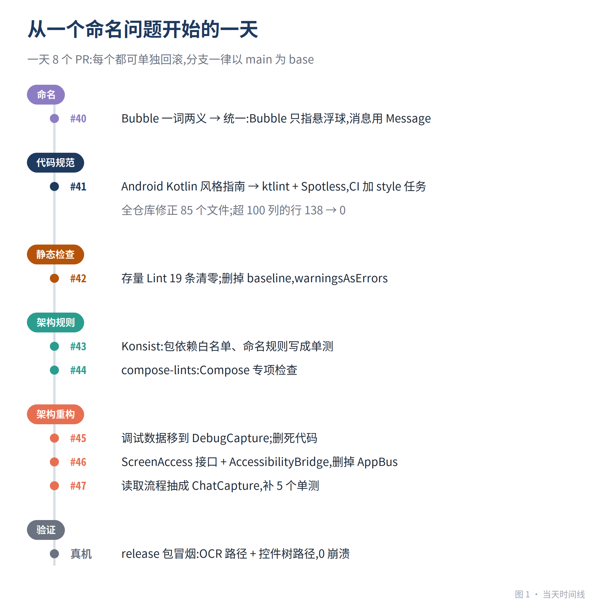
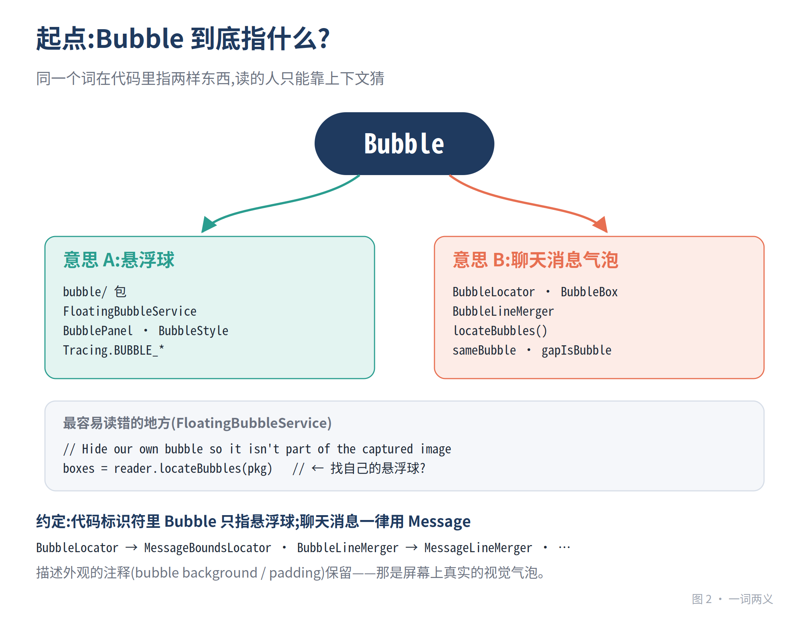
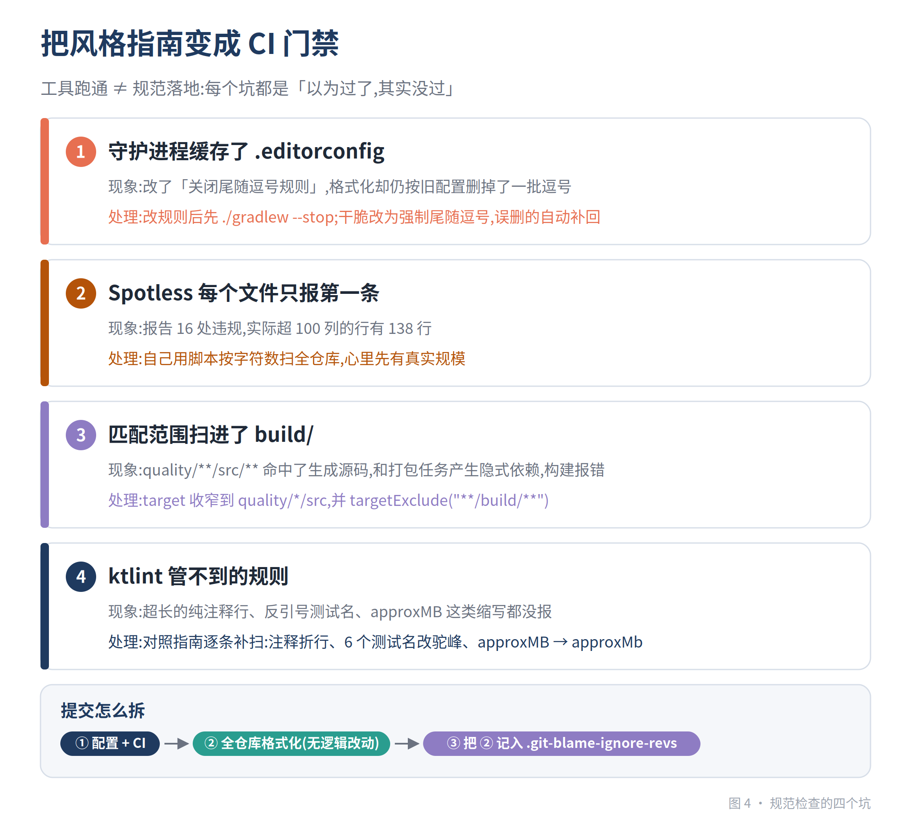
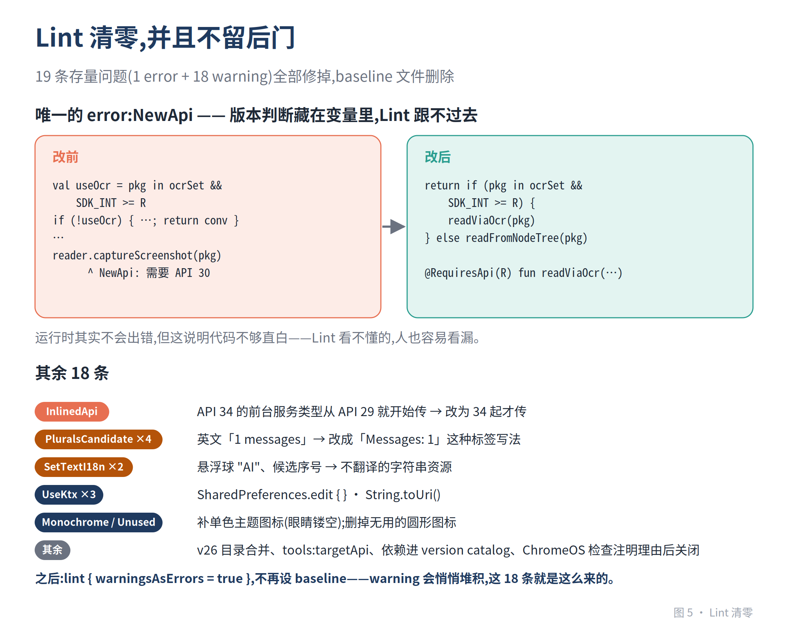
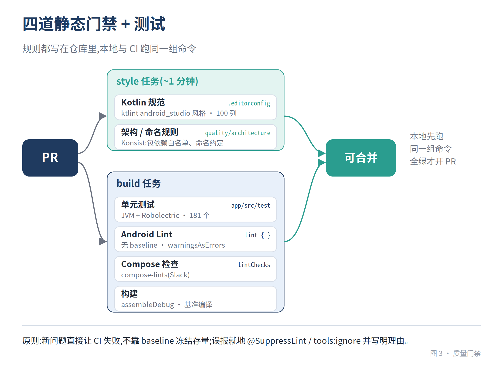
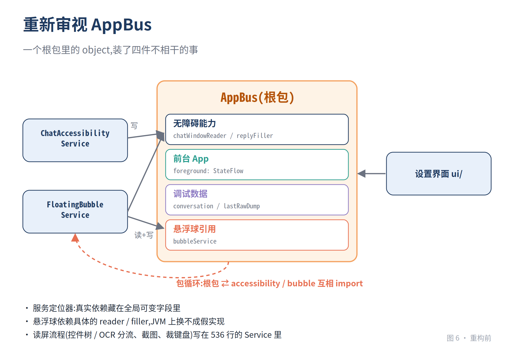
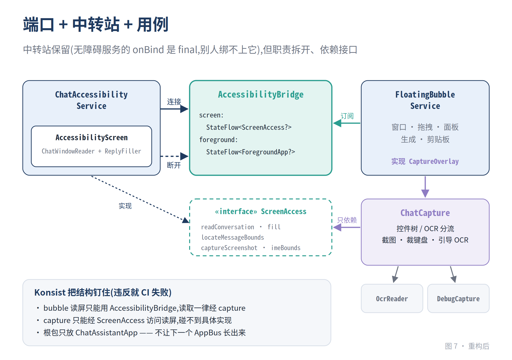
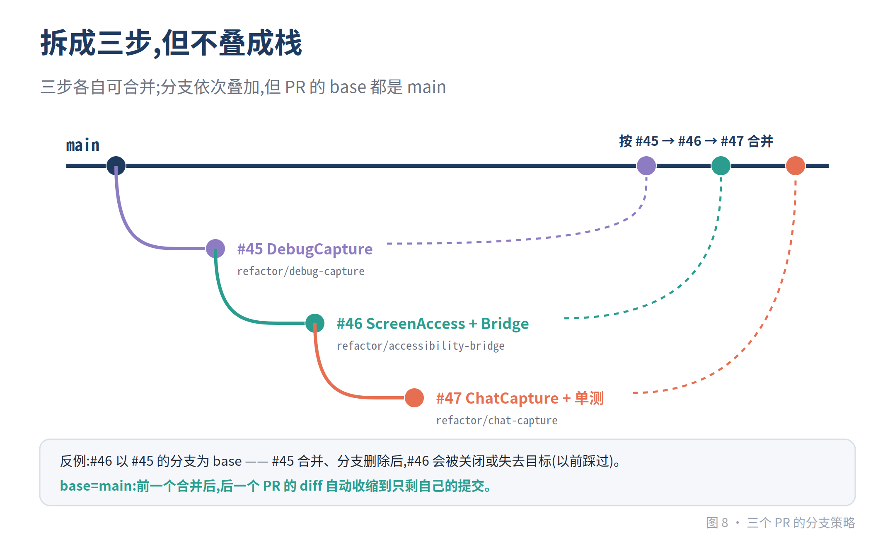
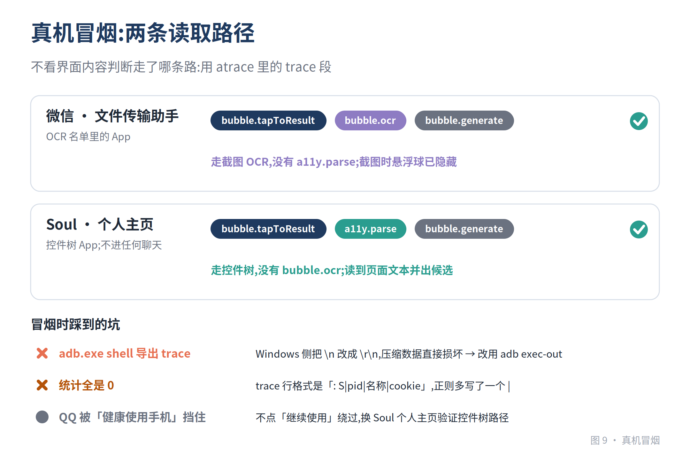

# 从一个词的歧义开始:命名、规范、Lint、架构规则与一次"去全局单例"重构

> 上一篇复盘里,我们用 21 个 PR 给一个读屏 AI 聊天助手补齐了测试、性能、可靠性和可观测性。这一篇记录紧接着的一天:起因只是有人指出"`BubbleLocator` 这个名字有歧义",结果一路做下去——统一命名、把 Android 官方风格指南变成 CI 门禁、把 Lint 存量清零、把架构约定写成测试,最后把一个"什么都往里放"的全局单例拆掉。8 个 PR,外加一次真机冒烟。**这一路上踩到的坑,有一半来自工具"看起来跑通了"。**

---

## 一、背景

这个 App 的核心链路是这样的:

- 一个**无障碍服务**(`ChatAccessibilityService`)读取微信、QQ、Soul 等聊天 App 的屏幕;读不到文字的 App(比如微信)改为截屏 + OCR;
- 一个**悬浮球服务**(`FloatingBubbleService`)常驻在屏幕边上,用户点一下,它向无障碍服务要"当前屏幕上的聊天",交给大模型生成候选回复;用户选中一条,再请无障碍服务把它填进输入框。

两个服务在同一个进程里,生命周期互不相关,中间靠一个叫 `AppBus` 的 `object` 互相找到对方。今天的故事,最后就落在它身上。



---

## 二、起点:`Bubble` 到底指什么?(#40)

用户的原话只有一句:"`BubbleLocator` 命名有歧义。"

查下去发现,`Bubble` 这个词在代码里指两样东西:



- `bubble/` 包、`FloatingBubbleService`、`Tracing.BUBBLE_*` 里,它是**悬浮球**;
- `BubbleLocator`、`BubbleBox`、`BubbleLineMerger` 里,它是**聊天消息气泡**。

最容易读错的地方在悬浮球服务里:上一行注释写着"把我们自己的 bubble 藏起来,免得被截进图里",下一行就是 `reader.locateBubbles(pkg)`——读起来像在找自己的悬浮球,实际是在找聊天消息的边框。

处理方式是**定一条约定,再一次性执行**:代码标识符里 `Bubble` 只指悬浮球,聊天消息一律用 `Message`。

| 旧 | 新 |
|---|---|
| `BubbleLocator` / `BubbleBox` | `MessageBoundsLocator` / `MessageBounds` |
| `locateBubbles()` | `locateMessageBounds()` |
| `BubbleLineMerger` | `MessageLineMerger` |
| `sameBubble` / `gapIsBubble` | `sameMessage` / `gapInsideMessage` |

描述外观的注释("bubble background""bubble padding")保留——那说的是屏幕上真实的视觉气泡,改成 message 反而不准。

**一个过程中的意外**:改到一半,工作区被另一个会话切到了别的分支,改动落在了错误的地方。我们先撤回,再用 `git worktree` 另开一个目录完成这次改名,不去动别人正在用的工作区。这条后来成了习惯:**发现工作区状态和预期不符,先停下来查,而不是继续改。**

> 这条约定后来被写进了架构测试(#43):名字里带 `Bubble` 的类型只能出现在 `bubble` 包里。约定只靠人记,迟早会被忘。

---

## 三、把风格指南变成 CI 门禁(#41)

第二个需求是:"按 Android Kotlin 风格指南做一个规范检查,上 CI。"

### 3.1 工具选择

- **ktlint 的 `android_studio` 代码风格**,它本身就是照这份指南实现的:100 列、4 空格缩进、禁止通配符 import、import 按 ASCII 排序、K&R 大括号、命名规则、KDoc 格式;
- **用 Spotless 挂到 Gradle 上**。它按文件路径匹配,不依赖 `kotlin-android` 插件——这个项目用的 AGP 9 内置了 Kotlin,很多按插件挂钩的工具会对不上;
- **规则写在 `.editorconfig`**,CI 新增一个独立的 `style` 任务,大约一分钟出结果。

### 3.2 四个"以为过了,其实没过"的坑



**坑 1:Gradle 守护进程缓存了 `.editorconfig`。** 指南对尾随逗号没有规定,我们一开始打算关掉相关规则。配置改了,但格式化仍然按旧配置执行,删掉了一批尾随逗号。原因是常驻的 Gradle 守护进程把第一次读到的配置缓存住了。最后的处理是:**改规则之后先 `./gradlew --stop`**;并且索性改成"多行列表强制尾随逗号"——项目本来就在用,还能自动修复,误删的逗号也就自动补回来了。

**坑 2:Spotless 每个文件只报第一条。** 自动格式化后,报告说剩 16 处违规。我们自己用脚本扫了一遍,超过 100 列的行实际有 138 行。工具的报告不等于真实规模,**动手之前先自己量一遍**。

**坑 3:匹配范围扫进了 `build/`。** `quality/**/src/**` 这样的写法命中了构建过程生成的源码,和打包任务之间产生了隐式依赖,Gradle 直接报错。收窄匹配范围,并显式排除 `**/build/**`。

**坑 4:ktlint 管不到的规则。** 检查全绿之后,我们又对照指南逐条看了一遍,发现还有:

- 超过 100 列的**纯注释行**,ktlint 没报;
- 6 个用**反引号命名**的测试方法(指南明确禁止,ktlint 在测试代码里默认放过);
- `approxMB` 这类缩写——指南要求按单词处理,写成 `approxMb`。

这些都补上了。**"检查通过"只说明工具认可,不说明规范落地。**

### 3.3 大批量格式化怎么提交

全仓库格式化改了 85 个文件。为了不让它淹没 `git blame`,提交拆成三个:

1. 只加配置和 CI;
2. 全仓库格式化 + 手工修正,**不含任何逻辑改动**;
3. 把第 2 个提交记入 `.git-blame-ignore-revs`,GitHub 的 blame 会自动跳过它。

相应地,这个 PR 要用 merge commit 合并,不能 squash——否则记下的提交号就失效了。

---

## 四、Lint 清零,并且不留后门(#42)

项目里原本有一个 `lint-baseline.xml`,冻结着 19 条存量问题(1 个 error、18 个 warning),只拦新增。这次把它们全部修掉,然后**删掉 baseline,打开 `warningsAsErrors`**。



### 4.1 唯一的 error:藏在变量里的版本判断

截图 OCR 需要 API 30,原代码是这样判断的:

```kotlin
val useOcr = pkg in ocrSet && Build.VERSION.SDK_INT >= Build.VERSION_CODES.R
if (!useOcr) { /* 读控件树 */ return conv }
// …
reader.captureScreenshot(pkg)   // NewApi:需要 API 30
```

运行时其实不会出错,但 Lint 跟踪不到"布尔变量里藏着一个版本判断"这层数据流。我们没有简单地压掉警告,而是让代码变直白:OCR 分支抽成 `@RequiresApi(R)` 的 `readViaOcr()`,版本判断直接写在调用处。**Lint 看不懂的地方,人也容易看漏。**

### 4.2 其余 18 条里值得一提的

- **前台服务类型**:`FOREGROUND_SERVICE_TYPE_SPECIAL_USE` 是 API 34 才有的常量,原代码从 API 29 就开始传。服务类型到 34 才强制要求,所以改成 34 起才传——这是一个真实的兼容性问题,不只是"消警告";
- **英文复数**:原来会显示 "1 messages"。改成 "Messages: 1" 这种"标签: 数字"的写法,单复数都通顺,调用代码不用改;
- **主题图标**:补了 Android 13 的单色主题图标。前景图是白色气泡加两只紫色眼睛,单色图标只看透明度,直接复用的话眼睛会和气泡染成同色而消失,所以单独画了一张"眼睛镂空"的版本;
- **ChromeOS x86_64 支持**:项目有意只打 ARM 包,这条检查关闭,并在配置里写明理由。

### 4.3 为什么要 `warningsAsErrors`

这 18 个 warning 就是在"只有 error 才让构建失败"的配置下悄悄攒起来的。现在的规则是:**新问题直接让 CI 失败;确属误报的,在出问题的位置用 `@SuppressLint` / `tools:ignore` 压掉并写明理由,不再引入 baseline。**

---

## 五、把架构约定写成测试(#43、#44)

同一天上午,另外两个 PR 把"约定"变成了可执行的检查:

- **Konsist**(#43):一个只含测试的 JVM 模块,读取 app 的源码,检查**包之间谁能 import 谁**(白名单)和**命名约定**(`Bubble` 只在 `bubble` 包、`*ViewModel` 必须继承 androidx 的 ViewModel、禁用 `Impl`/`Manager`/`Helper` 这类含糊后缀……)。违规时直接列出"哪个文件 import 了什么";
- **compose-lints**(#44):Slack 出的 Compose 专项 Lint 规则,修掉了 4 处在函数体里直接取 ViewModel 的写法。

到这里,门禁一共四道静态检查加测试:



---

## 六、重新审视 AppBus(#45–#47)

### 6.1 问题

用户的问题是:"`AppBus` 连接了两个 service,重新审视一下它们之间的关系,有没有更好的架构?"



`AppBus` 是根包里的一个 `object`,装了四件不相干的事:

| 职责 | 问题 |
|---|---|
| 无障碍能力(读取器、回填器) | 两个字段分开赋值、分开读取,理论上可能读到不一致的组合;连接状态是普通变量,不能订阅 |
| 前台 App | 本身没问题,只是放错了地方 |
| 调试数据 | 含聊天原文,和服务连接无关 |
| 悬浮球服务的引用 | 只写不读的死代码,还为它压了一条内存泄漏警告 |

更深的问题是:

- **服务定位器**:悬浮球真正依赖什么,从签名上看不出来;它依赖的是具体的读取器和回填器类,在 JVM 测试里换不成假实现;
- **包循环**:根包的 `AppBus` 引用了两个服务所在包里的类,这两个包又引用 `AppBus`;
- **业务流程放错了地方**:"该读控件树还是截图 OCR、怎么截、怎么裁掉键盘"写在 536 行的悬浮球服务里,和窗口管理、拖拽、剪贴板混在一起。

### 6.2 中转站要不要留?

第一个问题不是"怎么拆",而是"能不能不要它"。答案是**要留**:Android 的 `AccessibilityService.onBind` 是 `final` 的,无障碍服务只能由系统绑定,App 自己的组件绑不上它。它只能把能力发布到进程内的某个地方。也不值得为两个服务引入 Hilt 这样的依赖注入框架。

**问题不在于有中转站,而在于它的形态。**

### 6.3 新结构



- **`ScreenAccess` 接口**:无障碍服务连接期间对外提供的能力——读会话、取消息边框、截图、取键盘区域、回填。每次连接发布一个实现,断开时撤回;
- **`AccessibilityBridge`**:只做一件事,用两个 `StateFlow` 发布"当前连接"和"前台 App"。断开用 `compareAndSet`,服务重连后旧连接的断开不会把新连接清掉;
- **`ChatCapture`**:从悬浮球服务里抽出来的读取流程,只依赖 `ScreenAccess`。"截图时把悬浮球藏起来"是窗口的事,仍留在服务里,通过一个小接口 `CaptureOverlay` 传进来;
- **`DebugCapture`**:调试数据单独放,只依赖数据层。

读屏事件的热路径一行没动。上一篇说过,这个项目的约定是**热路径性能优先于可测性**;这次的改动只在用户点击时多一次 `StateFlow.value` 读取和一次接口调用。

结构用 Konsist 钉住:悬浮球读屏只能用 `AccessibilityBridge`,读取一律经过 `ChatCapture`;`ChatCapture` 只能通过 `ScreenAccess` 访问读屏;**根包只能放 Application 类**——不让下一个 `AppBus` 长出来。

### 6.4 拆成三个 PR,但不叠成栈



三步各自独立可合并:#45 只搬家(零风险),#46 引入接口并删掉 `AppBus`,#47 抽出 `ChatCapture` 并补测试。分支依次叠加,但**三个 PR 的 base 都设成 main**。以前踩过的坑是:如果 #46 以 #45 的分支为 base,#45 合并、分支删除后,#46 会被关闭或失去目标。base 设成 main 时,前一个合并后,后一个的 diff 会自动收缩到只剩自己的提交。

### 6.5 给测试做测试

- **规则的反向验证**:临时让悬浮球直接 import 读取器的具体类,架构测试应当失败——它确实失败了,并指出了具体文件和那条 import;
- **变异测试**:`ChatCapture` 有 5 个 Robolectric 单测。我们故意删掉"截图时隐藏悬浮球"这一步,`ocrAppIsCapturedWithTheOverlayHidden` 应当失败——它确实失败了,失败原因也对。

一个从来没失败过的测试,你不知道它是不是真的在测东西。

---

## 七、真机冒烟

三个 PR 合并后,用 release 包在真机上验证。原则延续上一篇:微信只在「文件传输助手」里点测;每一步先截图确认画面,不盲点坐标;关面板按 Home 键;不用 UiAutomator(它会暂停被测的无障碍服务);截图用完即删。



判断"走了哪条读取路径",**不看界面内容,看 trace 段**:控件树路径会留下 `a11y.parse`,OCR 路径会留下 `bubble.ocr`。两次点击分别对上了。

冒烟本身也踩了坑:

- **QQ 被「健康使用手机」挡住**:今日可用时长已用完。这是机主自己设的限制,我们没有点"继续使用"绕过,改用 Soul 的**个人主页**验证控件树路径——不进任何聊天,同样能触发读取;
- **trace 导出后解压失败**:在 Windows 侧用 `adb.exe shell` 导出,换行被改成了 `\r\n`,压缩数据直接损坏。改用 `adb exec-out`;
- **统计结果全是 0**:trace 行的格式是 `: S|pid|名称|cookie`,正则多写了一个 `|`。全是 0 的时候,先怀疑自己的统计,再怀疑被测对象——两次点击明明都出了结果。

---

## 八、过程中发现的问题清单

| 在哪个环节发现 | 问题 | 性质 |
|---|---|---|
| 读代码 | `Bubble` 一词两义 | 可读性 |
| 读代码 | `AppBus` 四种职责、服务定位器、包循环 | 可维护性 |
| 读代码 | `bubbleService` 只写不读 | 死代码 |
| Lint | 前台服务类型在 API 29–33 上就传了 34 的常量 | 兼容性 |
| Lint | 英文界面 "1 messages" | 易用性 |
| Lint | 版本判断藏在变量里 | 可读性 |
| 对照指南人工补扫 | 超长注释、反引号测试名、`approxMB` | 规范 |
| **工具本身** | 守护进程缓存配置,误删尾随逗号 | 工具 |
| **工具本身** | Spotless 每个文件只报一条 | 工具 |
| **工具本身** | 匹配范围扫进 `build/`,隐式依赖报错 | 工具 |
| **工具本身** | `adb.exe shell` 损坏二进制输出 | 工具 |
| **我们自己** | 工作区被别的会话切了分支,改动落错地方 | 流程 |
| **我们自己** | `git add -A docs` 把工作区里未跟踪的文章草稿一起带进了提交 | 流程 |
| **我们自己** | trace 统计的正则写错,得出"全是 0" | 测试本身 |

最后三行值得单独说。`git add -A <目录>` 很方便,但它会把这个目录下**所有**未跟踪的文件一起加进去——包括和本次改动毫无关系的草稿。之后的做法是:**只 add 本次改动涉及的具体路径,提交前看一眼 `git status`。**

---

## 九、几条可以带走的经验

1. **命名问题值得当真**。一个词两个意思,读代码的每个人都要多花一次心思;定一条约定、一次改完、写进测试,成本远低于长期的误读。
2. **"工具跑通"不等于"规范落地"**。缓存、只报第一条、规则盲区——每一个都会让你以为过了。动手之前先自己量一遍真实规模。
3. **不留 baseline 后门**。baseline 适合起步,但长期保留,warning 就会悄悄堆积。清零之后用 `warningsAsErrors` 守住。
4. **Lint 看不懂的代码,人也容易看漏**。与其压掉警告,不如把代码改到连工具都看得懂。
5. **先问"能不能不要",再问"怎么拆"**。`AppBus` 必须存在是平台约束决定的;要改的是它的形态,而不是它的存在。
6. **约定写成测试**。命名规则、包依赖、"根包只放 Application",写进 Konsist 之后,不再依赖每个人都记得。
7. **给测试做测试**。反向验证规则、变异测试、对"全是 0"保持怀疑——没失败过的测试,不知道它在不在工作。
8. **真机验证要安全**。看 trace 而不是看聊天内容;不绕过机主设的限制;不盲点坐标;截图用完即删。

---

**数字速览**

- 8 个 PR(#40–#47),外加一次真机冒烟
- 规范:全仓库 85 个文件格式化,超过 100 列的行 138 → 0,反引号测试名 6 → 0
- Lint:存量 19 条(1 error + 18 warning)→ 0,baseline 删除,`warningsAsErrors` 打开
- 门禁:ktlint、Konsist、Android Lint、compose-lints 四道静态检查 + 181 个单元测试
- 重构:`AppBus` 的 4 种职责拆到 3 个各管一件事的类型 + 1 个用例;悬浮球服务 536 → 477 行;新增 5 个单测
- 真机:两条读取路径各验证一次,0 崩溃、0 ANR

*文中没有任何真实聊天内容;配图均为示意。*
